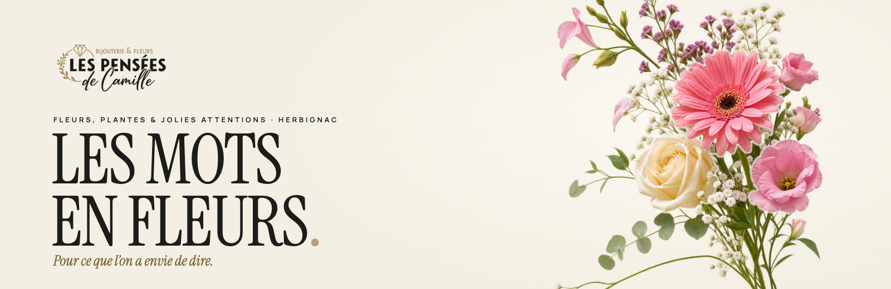
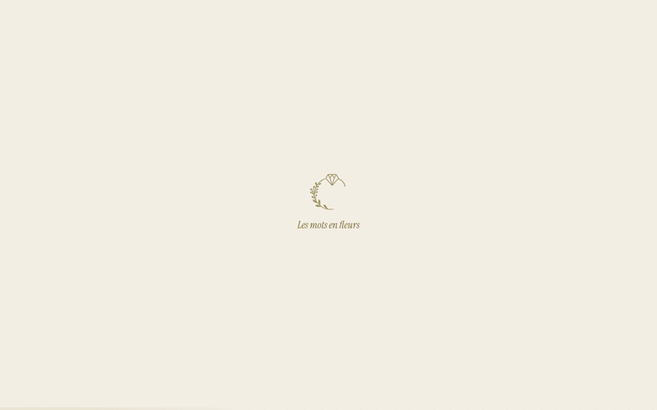
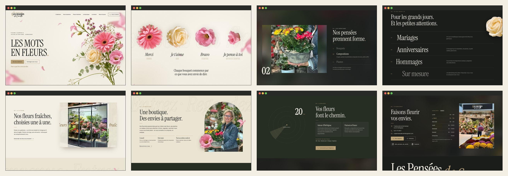
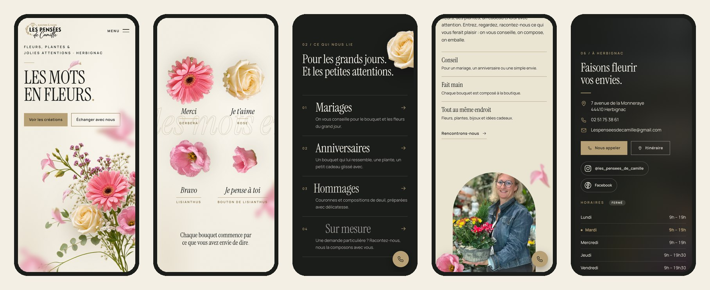

<div align="center">



<h3>A one-page website for a florist and jewellery boutique in Herbignac, where the bouquet blooms flower by flower and then unties itself into a sentence.</h3>

<p>
  <a href="#hero-animation"><strong>🎬 How the hero works</strong></a>
  &nbsp;·&nbsp;
  <a href="#sections"><strong>🖥️ Sections</strong></a>
  &nbsp;·&nbsp;
  <a href="#getting-started"><strong>🛠️ Run it locally</strong></a>
</p>

<p>
  
  
  
  
</p>

</div>

<br />

## 🚀 Overview

**Les Pensées de Camille** is a florist, jewellery and gift boutique at 7 avenue de la Monneraye in Herbignac, France. The site is built from the approved board *Les Mots en Fleurs* around one idea: **flowers say something before anyone explains them**. So the hero bouquet is not one picture. It is five registered layers, and on scroll each flower leaves the bouquet and becomes a word: *Merci*, *Je t’aime*, *Bravo*, *Je pense à toi*.

Seven chapters in French take visitors from that first sentence to the shop door. Each chapter has its own scroll choreography, built with GSAP and ScrollTrigger, and the same four flowers keep coming back along the way.

- **A hero that blooms**: the greenery grows up from the stems, then the gerbera, the rose and the lisianthus spring open one after another while the title rises letter by letter
- **The bouquet becomes a sentence**: the hero holds the screen while the flowers travel into a row and a word appears under each one
- **Everything from the shop's current site**: bouquets, compositions, plants, single stems, jewellery and gifts, weddings, birthdays and funeral flowers, delivery within 20 km and across France, payment methods, opening hours and contact details
- **The real shop**: every photo below the hero is the boutique's own, shown at its real size with the viewer controls cropped out
- **Clear path to the shop**: phone number in the header, a call button on phones, route, email, Instagram and Facebook
- **Light**: 1.30 MB on first load on a phone, with no framework and nothing loaded from a CDN

<br />

<a name="hero-animation"></a>

## 🎬 The hero animation

<div align="center">
  
  <sub>Captured from the running page at 1440 × 900</sub>
</div>

<br />

The opening plays once per visit. Everything after it is tied to the scroll and plays backwards when the visitor scrolls back up:

| Scroll                              | What happens                                                                                                                                                  |
| :---------------------------------- | :------------------------------------------------------------------------------------------------------------------------------------------------------------ |
| Load                                | The emblem turns in on an ivory cover, the cover lifts, and the greenery grows up from the stems while it swings 6° into place                                |
|                                     | The four flowers spring open from nothing with an elastic turn, 150 ms apart. The title rises out of its own mask one letter at a time, and the petals drift in |
| At rest                             | The bouquet breathes on a 4.6 s cycle. On a desktop, each flower follows the pointer at its own depth                                                          |
| **Les mots en fleurs.** · pinned    | The hero holds for 1.7 screens. The title lifts away, the greenery sinks, and each flower turns and travels to its place in a row                             |
|                                     | A word rises under each flower, a giant outlined *les mots en fleurs* slides behind them, and the petals fall across the scene                                |
| Band                                | Two rows of very large type run against each other with the scroll                                                                                           |
| **Nos pensées prennent forme.** · pinned | The first photo opens from the centre, then the scene holds while the next photos wipe over it, one from below and one from the side. The index and the *01 / 03* counter follow |
| **Pour les grands jours.**          | The four occasions slide in from opposite sides, the rose turns as it crosses the scene, and the diamond draws itself. On a desktop, a flower follows the pointer over the list |
| **Nos fleurs fraîches**             | Two frosted doors slide apart over the photo of the shop's own flower cabinet                                                                                  |
| **Une boutique.**                   | The portrait opens upwards inside an arch, a lisianthus rolls in at its foot, and outlined words drift across the background                                  |
| **Vos fleurs font le chemin.**      | The radius rings grow outwards from Herbignac while the counter runs from 0 to 20 km                                                                           |
| **Faisons fleurir vos envies.**     | The shopfront rises inside its frame and the opening hours arrive row by row, with today's row marked                                                          |
| Footer                              | The *Les Pensées de Camille* wordmark rises letter by letter as the page ends                                                                                  |

**Under the hood**

- 🌸 **One bouquet, five layers.** `scripts/prepare-hero.py` cuts the gerbera, the rose and the two lisianthus out of the campaign bouquet with OpenCV GrabCut and writes their positions to `layers.json`. Each flower sits back on the greenery at the same pixels, so the assembled bouquet is identical to the original picture.
- 📍 **Landing spots measured in the browser.** The row is not a set of fixed offsets. On every refresh the script measures where each flower sits and where it has to land for the current window, so the same timeline gives a row of four on a desktop and a two by two grid on a phone.
- 🎛️ **Motion as a layer on top.** The static page is complete on its own. The whole choreography lives in one `gsap.context()`. The *Mettre l’animation en pause* button in the footer reverts every tween and pin, and starts them again on request.
- 🖼️ **Photos at their real size.** The shop's photos are never stretched to fill the window. A blurred copy of the same photo fills the space around them, and the browser QA fails if a photo is drawn above 1.12 times its own pixels.
- 🐢 **Graceful by default.** With `prefers-reduced-motion`, or without JavaScript, there is no cover, no pin and no hidden text. Scrolling stays native in every case.

<br />

<a name="sections"></a>

## 🖥️ Sections

<div align="center">
  
</div>

<br />

| #   | Section                                       | Anchor        | Role                                                                                              |
| :-- | :-------------------------------------------- | :------------ | :------------------------------------------------------------------------------------------------ |
| 01  | **Les mots en fleurs.**                       | `#accueil`    | First impression, two calls to action, then the bouquet turned into a sentence                    |
| 02  | **Nos pensées prennent forme.**               | `#creations`  | Bouquets, compositions and plants, each with a real photo from the shop                           |
| 03  | **Pour les grands jours. Et les petites attentions.** | `#occasions` | Weddings, birthdays, funeral flowers and custom requests, then jewellery and gift ideas     |
| 04  | **Nos fleurs fraîches, choisies une à une.**  | `#fraicheur`  | The fresh flower cabinet and stems sold one by one                                                |
| 05  | **Une boutique. Des envies à partager.**      | `#boutique`   | The people and the advice behind the counter                                                      |
| 06  | **Vos fleurs font le chemin.**                | `#livraison`  | Delivery within 20 km, delivery across France and the payment methods                             |
| 07  | **Faisons fleurir vos envies.**               | `#contact`    | Address, phone, email, route, Instagram, Facebook and the opening hours with an open or closed badge |
| 08  | Footer                                        | `.footer`     | Wordmark, navigation, social icons, practical information and the motion switch                   |

<br />

## 📱 Mobile first, motion optional

<div align="center">
  
</div>

<br />

- Below 900 px the page has its own composition: title and buttons first, the bouquet underneath, and a full-screen menu
- The hero still holds on a phone, and the flowers land in a two by two grid. The creations scene is not pinned there; its photos wipe as they pass
- A round call button stays within reach between the hero and the contact scene
- No horizontal scroll from 360 to 1920 px wide and no text under 9.5 px (checked in the browser QA)
- Pointer effects only run on fine pointers; nothing depends on hover

<br />

## ✨ Highlights

- **🌷 Flowers that come back**: the rose turns through the occasions, a lisianthus rolls in beside the portrait, and any of the four follows the pointer over the occasions list
- **🕘 Opening hours that know the day**: today's row is marked and an *Ouvert* or *Fermé* badge is worked out in Paris time
- **📞 Real contact only**: phone, email, route and social links. The site takes no orders and shows no invented confirmation
- **🔗 Hand-drawn social icons**: Instagram and Facebook as inline SVG, in the same line weight as the rest of the icon set
- **🔒 Nothing external**: fonts, scripts and images are all served from the site. Instagram, Facebook and Google Maps open only on a click
- **🧪 Browser QA**: `npm run qa` runs 202 checks across 7 window sizes. It covers overflow, hero height, the sentence of flowers, anchors, real pointer hits on the contact buttons, upscaled photos, tiny text, every fact on the page, the dialog, the motion switch, reduced motion and no JavaScript
- **🔎 Preview mode**: `noindex` until the shop's own domain is live

<br />

## 💻 Tech stack

| <br />HTML5 | <br />CSS3 | <br />JavaScript | <br />GSAP | <br />Python | <br />OpenCV | <br />Playwright | <br />FFmpeg |
| :---: | :---: | :---: | :---: | :---: | :---: | :---: | :---: |

### Why this stack?

- **Static HTML, CSS and JavaScript**: the `site/` folder is the whole website, with no build step and no framework runtime. It can be put on any static host
- **GSAP 3.13 and ScrollTrigger**: scrubbed timelines and two pins. They ship as two vendored files in `site/vendor/` (117 KB on disk), so the site loads nothing from a CDN
- **Python, OpenCV and Pillow, offline only**: they cut the bouquet into layers, cropped the shop's photos and made the WebP exports and the logo variants. The site never depends on them
- **Playwright and FFmpeg**: the browser QA and the captures in this README

<br />

## 🎨 Design system

| Token       | Value     | Role                                              |
| :---------- | :-------- | :------------------------------------------------ |
| Ivoire      | `#F3EFE4` | Hero, light chapters, paper                       |
| Ivoire 2    | `#EAE4D3` | The boutique chapter                              |
| Encre       | `#1B1D1B` | Text on light, dark chapters                      |
| Or mat      | `#B7A075` | Emblem, rules, gold buttons with dark text        |
| Or lisible  | `#7A6235` | Small labels and outlines on ivory                |
| Feuille     | `#262E24` | The delivery chapter                              |

- **Instrument Serif** for titles, the index and the words under the flowers; its italic for the flower words and the outlined type
- **Manrope** for navigation, text, labels and buttons
- Both are self-hosted under the SIL Open Font License; the files and licences are in `fonts/`

<br />

<a name="getting-started"></a>

## 🛠️ Getting started

```bash
git clone https://github.com/Jeanfr1/Les-Pensees-De-Camille-Website.git
cd Les-Pensees-De-Camille-Website
npm install
npm run dev        # serves site/ on http://localhost:4451
```

| Command                             | What it does                                                        |
| :---------------------------------- | :------------------------------------------------------------------ |
| `npm run dev`                       | Serves the static `site/` folder                                    |
| `npm run qa`                        | Runs the 202 browser checks (`QA_BASE=https://…` tests a live URL)  |
| `npm run assets`                    | Rebuilds the bouquet layers, photo crops and logo variants          |
| `node scripts/readme-assets.mjs`    | Re-captures the banner, the GIF and the screenshots of this README  |

<br />

## 📁 Project structure

```
├── site/                    The website (deploy this folder)
│   ├── index.html           Seven chapters, icon sprite, dialog
│   ├── styles.css           Tokens, layout, phone composition
│   ├── app.js               Interface + GSAP choreography
│   ├── vendor/              GSAP 3.13 + ScrollTrigger
│   └── assets/              Fonts, brand, photos, hero layers
├── scripts/                 prepare-hero.py · prepare-images.py · qa.mjs · shots.mjs · readme-assets.mjs
├── images/                  Untouched originals and the campaign bouquet
├── brand/ · fonts/          Restored logo, tokens, font files and licences
├── roteiros/ · docs/ · motion/ · references/   The design kit the site was built from
└── LEIA-ME-KIT.md           The kit's own notes (Portuguese)
```

<br />

## 🚀 Deployment

The site is a static folder. On Vercel, set the output directory to `site` with no build command (`vercel.json` already says so). The page ships with `noindex` and has not been published yet.

<br />

## 📌 Content checklist

Waiting on the shop, marked `TODO(camille)` in the code:

- [ ] Official logo file. The one on the page is a restored raster of the current shopfront logo
- [ ] Opening hours on public holidays and any seasonal change (the page shows Monday to Wednesday 9h–19h, Thursday to Saturday 9h–19h30, closed on Sunday)
- [ ] Delivery conditions and prices for the 20 km radius and for the rest of France
- [ ] Legal notice: company name, registration number, publication director and host
- [ ] Permission to show the two people in the shop photos; nobody is named on the page
- [ ] More photos of bouquets, compositions, jewellery and gifts
- [ ] Own domain; then remove `noindex` and add the canonical and Open Graph image

Choices made where the kit and the request differed:

- The kit's script asked for no pinned scene and a single flower plane. The request for this build was a stronger hero, so the bouquet was split into layers and the hero and the creations scene are pinned
- The kit kept five chapters and put hours and delivery in a dropdown. They are now visible chapters, together with the fresh flower cabinet, so that everything on the shop's current site has its own place

<br />

## 🙏 Acknowledgments

- **Les Pensées de Camille** for the shop, the flowers and the photographs
- [GSAP](https://gsap.com) for the animation engine
- [Instrument Serif](https://github.com/Instrument/instrument-serif) and [Manrope](https://github.com/sharanda/manrope), both under the SIL Open Font License

<br />

<div align="center">

**Built with ❤️ by Jean**

</div>
